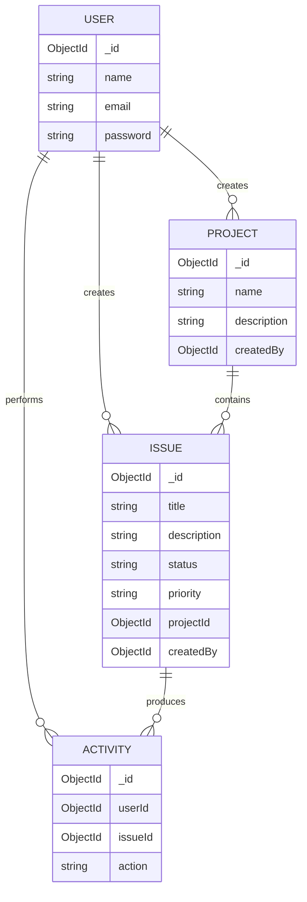
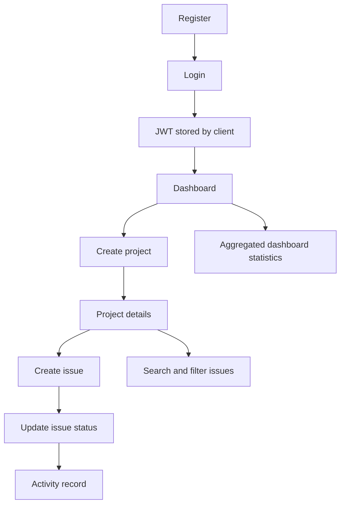

# SprintBoard Project Context

Technical reference for future development of SprintBoard, the project and issue management application created for the KvonTech Consultancy Services Pvt. Ltd. Full Stack Developer technical assessment.

## 1. Project identity and purpose

SprintBoard is a two-part MERN application:

- `client/`: a Vite React single-page application.
- `server/`: an Express API backed by MongoDB through Mongoose.

The application is intended for individual developers and small teams. An authenticated user can create projects, manage issues inside those projects, assign workflow status and priority, search and filter issues, review dashboard statistics, and view recent activity.

The current implementation supports collaborative project-management workflows but does **not** implement Socket.IO, server-pushed updates, team membership, roles, or permissions beyond ownership by the authenticated user.

## 2. Functional requirements

### Implemented

- Register an account with name, email, and password.
- Log in and receive a JWT.
- Protect project, issue, dashboard, and activity APIs.
- Create, list, retrieve, update, and delete owned projects.
- Create, retrieve, update, and delete issues in owned projects.
- Use exact issue statuses: `To Do`, `In Progress`, `Done`.
- Use exact priorities: `Low`, `Medium`, `High`.
- Search issues by title.
- Filter issues by status, priority, and project.
- Log activity for issue creation and issue updates.
- Aggregate dashboard statistics from MongoDB.
- Display responsive dashboard, project, issue, activity, login, and registration pages.

### Partial or pending

- Issue editing is API-capable for title, description, status, and priority, but the current project detail UI uses a browser prompt for title editing.
- `/auth/profile` has a controller but its route is not protected by `authMiddleware`.
- No Socket.IO or real-time synchronization exists.
- No roles, project membership, pagination, or automated end-to-end tests exist.

## 3. Technology stack and versions

### Client manifest

From `client/package.json`:

| Package | Declared version | Use |
|---|---:|---|
| `react` | `^19.3.1` | UI components |
| `react-dom` | `^19.3.1` | Browser rendering |
| `react-router-dom` | `^7.18.5` | Browser routes |
| `axios` | `^1.21.0` | API requests |
| `lucide-react` | `^1.66.0` | Interface icons |
| `vite` | `^8.3.5` | Dev server and bundler |
| `eslint` | `^10.13.0` | Frontend linting |
| `eslint-plugin-react-hooks` | `^7.1.1` | Hook lint rules |
| `eslint-plugin-react-refresh` | `^0.5.7` | React refresh lint rules |
| `@vitejs/plugin-react` | `^6.1.2` | Vite React integration |

The frontend uses JavaScript ES modules, React Hooks, and native CSS. No TypeScript dependency is present.

### Server manifest

From `server/package.json`:

| Package | Declared version | Use |
|---|---:|---|
| `express` | `^5.3.0` | HTTP API |
| `mongoose` | `^9.11.4` | MongoDB object modeling |
| `bcryptjs` | `^3.0.3` | Password hashing |
| `jsonwebtoken` | `^9.0.3` | JWT signing and verification |
| `cors` | `^2.8.6` | Cross-origin configuration |
| `dotenv` | `^18.0.9` | Environment configuration |
| `nodemon` | `^3.1.14` | Development restart utility |

Node.js is the runtime. MongoDB Atlas is the configured hosting target when `MONGODB_URI` points to Atlas.

## 4. Complete frontend architecture

### Browser route tree

`client/src/App.jsx` defines:

| Route | Component | Access |
|---|---|---|
| `/login` | `Login` | Public |
| `/register` | `Register` | Public |
| `/dashboard` | `Layout` + `Dashboard` | Protected |
| `/projects` | `Layout` + `Projects` | Protected |
| `/projects/:id` | `Layout` + `ProjectDetails` | Protected |
| `/issues` | `Layout` + `Issues` | Protected |
| `/activity` | `Layout` + `Activity` | Protected |
| `/` | Redirect to `/dashboard` | Router redirect |

`ProtectedRoute` checks `localStorage` for a token and redirects to `/login` when absent. It does not validate the token with the server before rendering.

### Shared components

- `Layout.jsx`: renders `Sidebar`, `Navbar`, and the page content area.
- `Sidebar.jsx`: renders Dashboard, Projects, Issues, and Activity navigation plus logout. Logout removes `token` and `user` from local storage.
- `Navbar.jsx`: reads the stored user summary and displays the user's initial and name.
- `ProtectedRoute.jsx`: client-side token-presence guard.
- `ActivityFeed.jsx`: requests `/activities`, displays populated user/action/issue/date information, and handles loading and empty states.
- `Toast.jsx`: displays a presentation-only success message when a page passes a message.

### Pages and state

- `Login.jsx`: local form state, login request, token/user persistence, loading state, and error state.
- `Register.jsx`: local registration form, loading state, and error state.
- `Dashboard.jsx`: requests `/dashboard/stats`, `/projects`, and `/issues` in parallel. It also listens for the browser `sprintboard:data-changed` event to refresh data.
- `Projects.jsx`: loads projects, creates projects, uses browser prompts for project-name editing, deletes projects, and dispatches `sprintboard:data-changed`.
- `ProjectDetails.jsx`: loads a project and filtered issue list, creates issues, updates status, edits issue title through a prompt, deletes issues, and dispatches the data-change event.
- `Issues.jsx`: loads projects for the project selector and debounces issue requests while search or filter state changes.
- `Activity.jsx`: page wrapper around `ActivityFeed`.

### API communication

`client/src/services/api.js` creates an Axios instance with base URL `http://localhost:5000/api`. Its request interceptor reads the local-storage token and sets the authorization header for API calls. The client does not use a configurable Vite environment variable for the API URL.

## 5. Complete backend architecture

### Startup

`server/server.js`:

1. Imports Express, Mongoose, dotenv, CORS, and all route modules.
2. Calls `dotenv.config()`.
3. Configures CORS with `CLIENT_URL` or `http://localhost:5173`.
4. Enables `express.json()`.
5. Registers `GET /`.
6. Mounts `/api/auth`, `/api/projects`, `/api/dashboard`, `/api/activities`, and `/api/issues`.
7. Connects with `mongoose.connect(process.env.MONGODB_URI)`.
8. Starts listening on `PORT` or `5000` after a successful connection.

### Middleware

`server/middleware/authMiddleware.js`:

1. Reads the token from the `Authorization` header after splitting it on a space.
2. Returns `401` if no token is present.
3. Verifies the token using `process.env.JWT_SECRET`.
4. Stores the decoded payload on `req.user`.
5. Calls `next()` for valid tokens.
6. Returns `401` for invalid or expired tokens.

## 6. Folder and file responsibilities

```text
server/
├── server.js
├── middleware/authMiddleware.js
├── models/
│   ├── User.js
│   ├── Project.js
│   ├── Issue.js
│   └── Activity.js
├── controllers/
│   ├── authController.js
│   ├── projectController.js
│   ├── issueController.js
│   ├── dashboardController.js
│   └── activityController.js
└── routes/
    ├── authRoutes.js
    ├── projectRoutes.js
    ├── issueRoutes.js
    ├── dashboardRoutes.js
    └── activityRoutes.js
```

- Route modules define HTTP verbs, paths, and middleware composition.
- Controllers validate request data, query Mongoose models, enforce ownership, create activity entries, and send responses.
- Models define collection fields, constraints, enum values, timestamps, and references.

## 7. MongoDB collection schemas

### `User`

Defined in `server/models/User.js`:

- `name`: required trimmed `String`.
- `email`: required unique lowercased trimmed `String`.
- `password`: required `String`.
- Mongoose timestamps.

### `Project`

Defined in `server/models/Project.js`:

- `name`: required `String`.
- `description`: optional `String`.
- `createdBy`: required `ObjectId`, references `User`.
- Mongoose timestamps.

### `Issue`

Defined in `server/models/Issue.js`:

- `title`: required `String`.
- `description`: optional `String`.
- `status`: `String`, enum `["To Do", "In Progress", "Done"]`, default `"To Do"`.
- `priority`: `String`, enum `["Low", "Medium", "High"]`, default `"Medium"`.
- `projectId`: required `ObjectId`, references `Project`.
- `createdBy`: required `ObjectId`, references `User`.
- Mongoose timestamps.

### `Activity`

Defined in `server/models/Activity.js`:

- `userId`: required `ObjectId`, references `User`.
- `issueId`: required `ObjectId`, references `Issue`.
- `action`: required `String`.
- Mongoose timestamps.

## 8. Database relationships



The schemas define references but do not define database-level cascade behavior. Controllers explicitly delete project issues when deleting a project and issue activities when deleting an issue. Project deletion does not currently remove related Activity documents.

## 9. Authentication and authorization workflow

### Registration

`POST /api/auth/register` in `authController.js`:

1. Reads `name`, `email`, and `password`.
2. Requires all fields.
3. Requires a password length of at least six.
4. Checks for an existing user by email.
5. Hashes the password using `bcrypt.hash(password, 10)`.
6. Creates the user.
7. Returns `201` with a message and id/name/email summary.

### Login

`POST /api/auth/login`:

1. Requires email and password.
2. Finds the user by email.
3. Compares the submitted password with the stored bcrypt hash.
4. Signs `{ id: user._id }` with `JWT_SECRET` and `expiresIn: "1d"`.
5. Returns the token and id/name/email summary.

### Protected resources

Project, issue, dashboard, and activity route modules use `authMiddleware`. Controllers use `req.user.id` to scope projects and then derive accessible issue ids from those projects. This provides ownership restrictions for the implemented resources.

### Known profile gap

`authRoutes.js` declares `GET /profile` without `authMiddleware`, while `getUserProfile` reads `req.user.id`. This is a source-level defect and should be fixed before relying on the profile endpoint.

## 10. JWT token handling

The server signs one-day JWTs using `process.env.JWT_SECRET`. The payload contains the user id. The middleware verifies the token and attaches the decoded payload to `req.user`.

The frontend stores the JWT under `localStorage` key `token` and the safe user summary under `localStorage` key `user`. `ProtectedRoute` checks only token presence. API requests use the Axios interceptor in `client/src/services/api.js`.

The current implementation uses local storage rather than HTTP-only cookies and has no refresh-token mechanism.

## 11. API architecture

### Route registration

```mermaid
flowchart LR
    Browser[React client] --> Axios[Axios service]
    Axios --> Express[Express server]
    Express --> Auth[/api/auth]
    Express --> Projects[/api/projects]
    Express --> Issues[/api/issues]
    Express --> Dashboard[/api/dashboard]
    Express --> Activities[/api/activities]
    Projects --> ProjectController[Project controller]
    Issues --> IssueController[Issue controller]
    Dashboard --> DashboardController[Dashboard controller]
    Activities --> ActivityController[Activity controller]
    ProjectController --> MongoDB[(MongoDB)]
    IssueController --> MongoDB
    DashboardController --> MongoDB
    ActivityController --> MongoDB
```

### Endpoint inventory

#### Authentication

| Method | Path | Controller | Middleware |
|---|---|---|---|
| POST | `/api/auth/register` | `registerUser` | None |
| POST | `/api/auth/login` | `loginUser` | None |
| GET | `/api/auth/profile` | `getUserProfile` | None currently; controller expects `req.user` |

#### Projects

`projectRoutes.js` applies `router.use(authMiddleware)` to all routes.

| Method | Path | Controller |
|---|---|---|
| POST | `/api/projects` | `createProject` |
| GET | `/api/projects` | `getProjects` |
| GET | `/api/projects/:id` | `getProjectById` |
| PUT | `/api/projects/:id` | `updateProject` |
| DELETE | `/api/projects/:id` | `deleteProject` |

#### Issues

`issueRoutes.js` applies `router.use(authMiddleware)` to all routes.

| Method | Path | Controller |
|---|---|---|
| POST | `/api/issues` | `createIssue` |
| GET | `/api/issues` | `getIssues` |
| GET | `/api/issues/:id` | `getIssueById` |
| PUT | `/api/issues/:id` | `updateIssue` |
| DELETE | `/api/issues/:id` | `deleteIssue` |

#### Dashboard

| Method | Path | Controller | Middleware |
|---|---|---|---|
| GET | `/api/dashboard/stats` | `getDashboardStats` | `authMiddleware` |

#### Activity

| Method | Path | Controller | Middleware |
|---|---|---|---|
| GET | `/api/activities` | `getRecentActivities` | `authMiddleware` |

#### Root health endpoint

| Method | Path | Behavior |
|---|---|---|
| GET | `/` | Returns `{ message: "SprintBoard Server is running successfully!" }` |

## 12. Project CRUD implementation

### Create

`createProject` requires a non-empty `name`, trims it, stores the optional description, and assigns `createdBy` from `req.user.id`. It returns `201`.

### List

`getProjects` converts the authenticated user id to an ObjectId, matches projects by `createdBy`, looks up issues from the `issues` collection, adds `issueCount`, removes the temporary issue array, and sorts by newest `createdAt`.

### Retrieve

`getProjectById` searches by both `_id` and `createdBy`. It returns `404` when the project is not owned by or unavailable to the user.

### Update

`updateProject` validates a provided name, updates only provided name/description fields, enables Mongoose validators, and returns the updated project.

### Delete

`deleteProject` deletes an owned project and then calls `Issue.deleteMany({ projectId: project._id })`. It does not delete associated Activity documents.

## 13. Issue CRUD implementation

### Create

`createIssue` requires title and project id, validates the project ObjectId, confirms the project belongs to the user, creates the issue, and creates an Activity record with `Created issue: ...`.

### List, search, and filtering

`getIssues` first finds projects created by the authenticated user. All issue queries use those project ids as their base filter. Optional filters are then applied:

- `status`: exact case-sensitive enum value.
- `priority`: exact case-sensitive enum value.
- `project` or `projectId`: validated project ObjectId restricted to the user's project ids.
- `search`: case-insensitive regular-expression match against `title`.

The response populates `projectId` with the project name and `createdBy` with name/email, then sorts newest first.

### Retrieve

`getIssueById` validates the issue id, restricts the issue to the user's project ids, and populates project name and creator name.

### Update

`updateIssue` validates the issue id and title, finds an issue in an owned project, validates any provided status and priority values, saves the changed fields, and creates an Activity record. Status changes use the action `Changed status from ... to ...`; other changes use `Updated issue: ...`.

### Delete

`deleteIssue` validates the id, deletes an issue in an owned project, and removes Activity records associated with that issue.

## 14. Dashboard statistics implementation

`getDashboardStats`:

1. Finds project ids where `createdBy` equals `req.user.id`.
2. Counts those projects.
3. Matches issues whose `projectId` is in that project-id set.
4. Uses a MongoDB aggregation `$group` to calculate:
   - `totalIssues`
   - `openIssues` when status is `To Do`
   - `inProgressIssues` when status is `In Progress`
   - `completedIssues` when status is `Done`
   - `highPriorityIssues` when priority is `High`
5. Returns zero values when no issue aggregation row exists.

The frontend dashboard requests this endpoint along with project and issue lists. Pages dispatch a browser `sprintboard:data-changed` event after relevant CRUD/status operations, and the dashboard listens for it.

## 15. Search and filtering implementation

The global issues page maintains `search`, `status`, `priority`, and `project` state. It waits 400 milliseconds after changes before requesting `/api/issues`.

The project detail page maintains `search`, `statusFilter`, and `priorityFilter` state and sends them with `projectId` to `/api/issues`. The backend accepts both `project` and `projectId`.

The backend validates status and priority against the exact enum values and returns `400` for invalid values.

## 16. Activity logging implementation

Activity is created by issue controllers:

- Issue creation logs `Created issue: <title>`.
- Issue updates log either a status-change message or `Updated issue: <title>`.

`getRecentActivities`:

1. Finds the current user's project ids.
2. Finds issue ids in those projects.
3. Matches Activity records by `userId` and issue ids.
4. Populates `userId.name` and `issueId.title`.
5. Sorts newest first and limits the response to ten records.

The frontend `ActivityFeed` displays user name, action, issue title, and localized creation time.

## 17. Frontend state management

The application uses local React state with `useState`; there is no Redux, Context provider, Zustand store, or server-state library. `useEffect` performs initial and dependency-driven requests. `useCallback` stabilizes the dashboard refresh function used by its event listener.

Authentication state is represented by local storage values rather than a React authentication context. CRUD pages update local state after successful requests and use the custom browser event to notify the dashboard.

## 18. API communication workflow

1. A page imports the shared Axios instance.
2. The instance uses the fixed base URL `http://localhost:5000/api`.
3. The request interceptor reads the stored token.
4. The page awaits the API response.
5. Successful data is written to local component state.
6. Errors are read from `error.response?.data?.message` where implemented.
7. Relevant mutations trigger a local refetch and `sprintboard:data-changed`.

The frontend does not use an API proxy or configurable environment-based API URL.

## 19. Error handling

### Backend

- Missing required input generally returns `400`.
- Invalid credentials return `401`.
- Missing/invalid JWT returns `401`.
- Missing owned resources generally return `404`.
- Controller catch blocks return `400` or `500` depending on operation.
- Some authentication catch responses include `error.message`, which may expose internal error details and should be hardened for production.

### Frontend

- Login, registration, project, project-detail, and dashboard pages display request errors.
- Activity and global issues currently log request errors to the console in some failure paths.
- Loading and empty states exist on the main data views.
- There is no centralized Axios response-error interceptor.

## 20. Environment configuration

`server/server.js` calls `dotenv.config()` and reads:

| Name | Read in | Purpose | Default |
|---|---|---|---|
| `PORT` | `server.js` | HTTP listening port | `5000` |
| `MONGODB_URI` | `server.js` | Mongoose connection string | None; required for startup |
| `JWT_SECRET` | `authController.js`, `authMiddleware.js` | JWT signing and verification | None |
| `CLIENT_URL` | `server.js` | CORS allowed origin | `http://localhost:5173` |

No credential values are included in this document. The inspected repository contains `server/.env`; there is no `.env.example` file currently present.

## 21. Application startup workflow

### Backend

From `server/`:

```powershell
npm install
npm start
```

`npm start` runs `node server.js`. Development mode is available through `npm run dev`, which runs `nodemon server.js`.

The process connects to MongoDB before calling `app.listen`. A failed connection logs an error and exits.

### Frontend

From `client/`:

```powershell
npm install
npm run dev
```

Production validation commands are:

```powershell
npm run lint
npm run build
npm run preview
```

## 22. Current implementation status

### Implemented

- React/Vite client and Express/Mongoose server.
- Registration, login, bcrypt hashing, and JWT generation.
- Client-side protected route redirect.
- Protected project, issue, dashboard, and activity API modules.
- Ownership-scoped project and issue queries.
- Project CRUD.
- Issue CRUD and exact status/priority validation.
- MongoDB dashboard aggregation.
- Search and filtering.
- Activity creation and recent activity retrieval.
- Responsive dark monochrome UI with Lucide icons.

### Partially implemented

- Profile retrieval exists but is not protected at route level.
- Issue and project editing in the UI uses browser prompts rather than forms or modals.
- Dashboard refresh events are browser-local, not server-synchronized.
- Error presentation is inconsistent between pages.
- The API base URL is fixed to localhost.

### Not implemented

- Socket.IO real-time synchronization.
- Role-based access and project membership.
- Pagination.
- Notification center or push notifications.
- Automated API/browser test suite.

## 23. Known bugs and limitations

1. `GET /api/auth/profile` is not wired through `authMiddleware`, but `getUserProfile` expects `req.user.id`.
2. Project deletion removes project issues but leaves their Activity records.
3. The frontend client base URL is hard-coded and is not environment-configurable.
4. Authentication is stored in local storage with no refresh-token mechanism.
5. `getRecentActivities` only returns activities whose `userId` is the current user, so it is not a team-wide activity stream.
6. Some frontend request failures are logged rather than shown as user-facing error states.
7. There is no pagination or server-side page-size parameter for list endpoints.
8. Error responses from some authentication catch blocks include raw `error.message`.
9. The frontend route guard checks token presence but does not verify token validity until an API request occurs.

## 24. Future development roadmap

Recommended improvements, in priority order:

1. Protect `/api/auth/profile` with `authMiddleware`.
2. Remove activity records when deleting a project, or define an explicit retention policy.
3. Add centralized backend error handling and request schema validation.
4. Add automated API tests for auth, ownership, CRUD, filters, dashboard counts, and activity.
5. Add a configurable client API URL for local, staging, and production environments.
6. Add pagination and indexes for title, project, status, priority, and created dates.
7. Introduce project membership and role-based permissions.
8. Add Socket.IO or another event transport for true real-time synchronization.
9. Replace browser prompts with accessible edit forms or modal dialogs.
10. Add durable notifications and a consistent frontend error boundary.

## Mermaid application workflow


